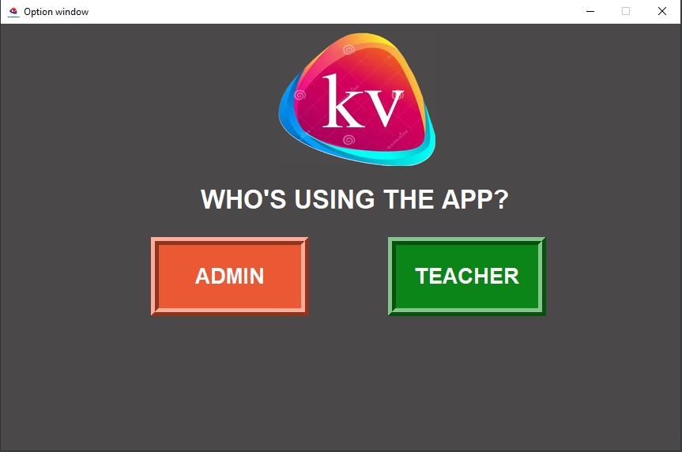
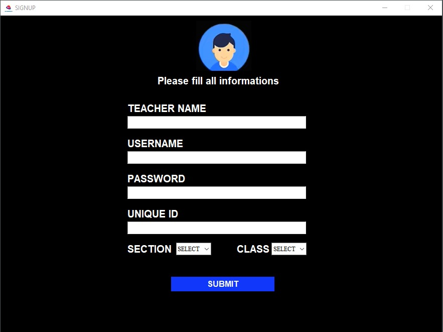
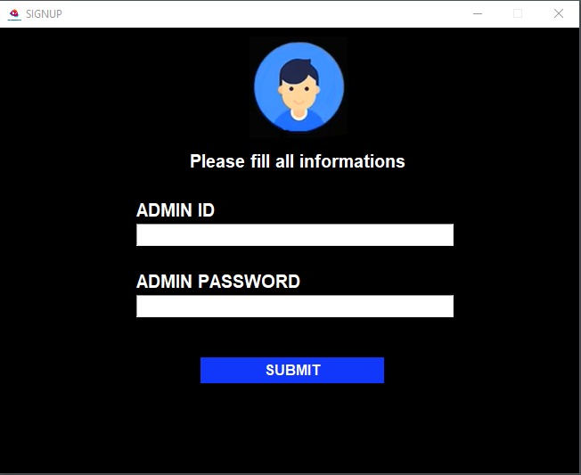
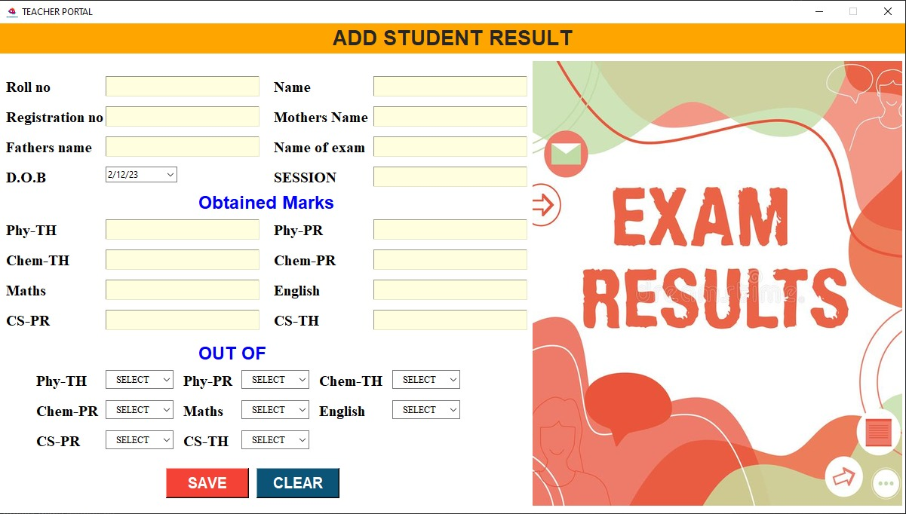
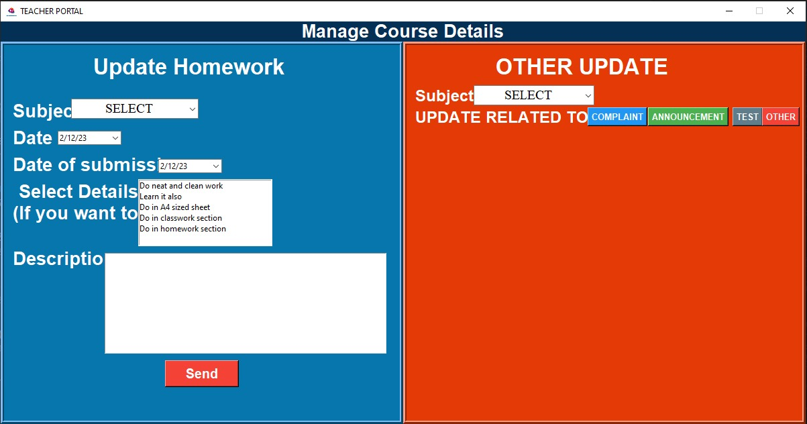
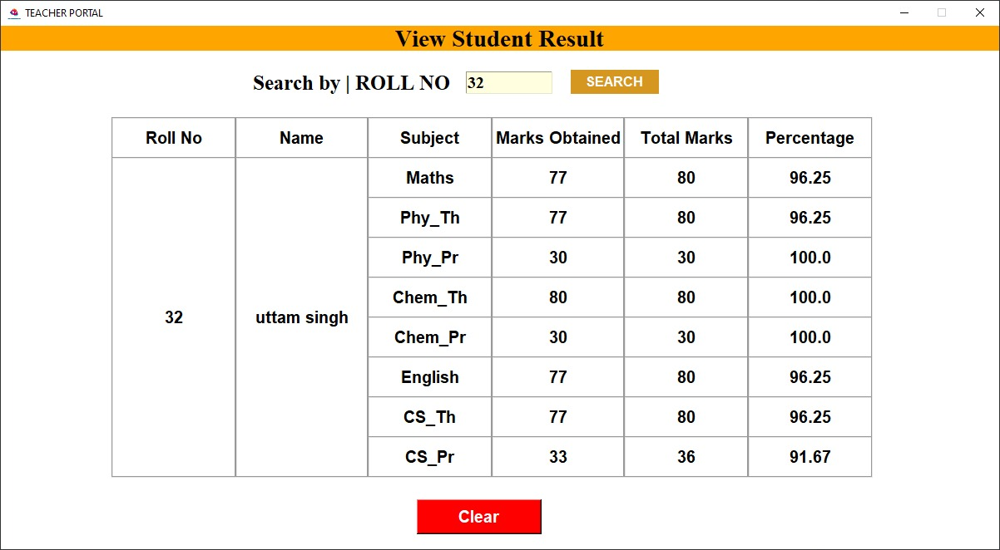
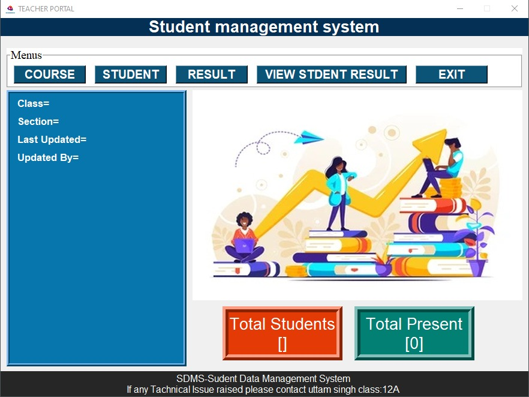
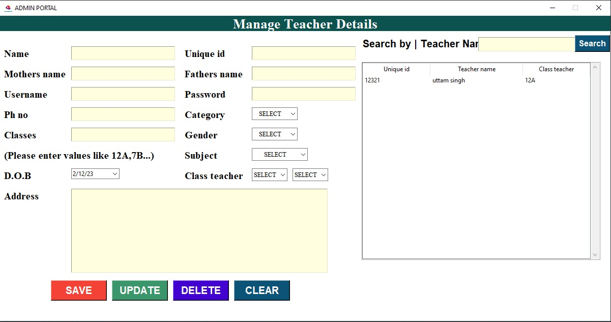
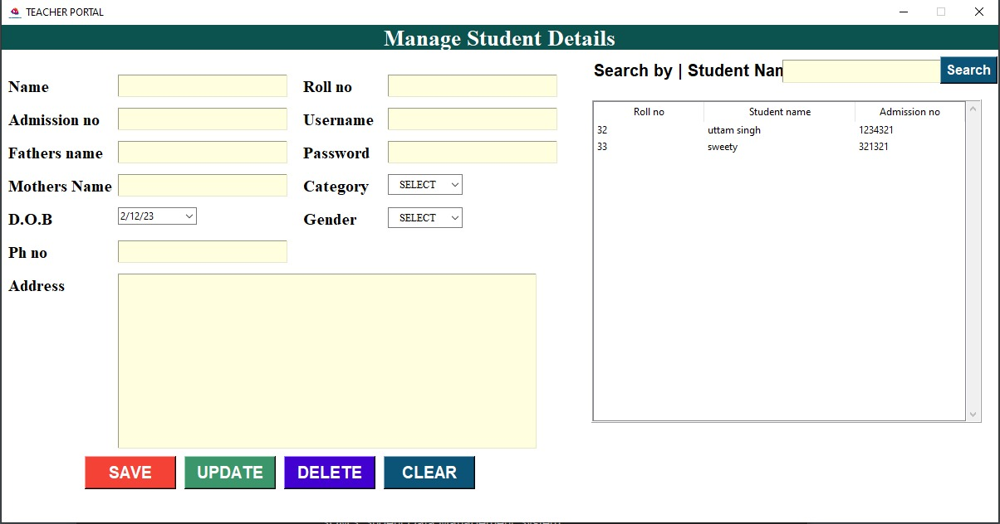

# School Management System (Tkinter + SQLite + Excel)

A role-based school management system built with Python, Tkinter, SQLite, and Pandas for Excel export.
### 1. Authentication & Role Selection
<p align="center">
  
  
  
</p>
This desktop app allows **Admins**, **Teachers**, and **Students** to manage and view school-related data including teacher records, student profiles, homework, announcements, and exam results — with support for downloading student results as Excel files.

---

## Project Structure

```
📦 Project Root
│
├── admin.py               # Admin management logic
├── teacher.py             # Teacher dashboard & logic
├── studentbtn.py          # Student management (teacher-side)
├── coursebtn.py           # Course & announcements (teacher-side)
├── getresult.py           # Result viewing logic
├── resultprinting.py      # Excel export for student results
├── main.py                # Entry point, role selection
│
├── Ad_lgn_win.py          # Admin login GUI
├── teach_lgn_win.py       # Teacher login GUI
├── stud_lgn_win.py        # Student login GUI
│
├── studata.xlsx           # Excel file storing student marks (temporary)
├── studata2.xlsx          # Backup/alternate Excel data
├── school.db              # SQLite database for teachers, students, login data
│
├── requirements.txt       # Python dependencies list
└── README.md              # This file
```

---

## Roles & Features

| Role    | Features                                                                                       |
|---------|------------------------------------------------------------------------------------------------|
| Admin   | - Add/Edit/Delete teachers<br>- Assign teachers to class & section<br>- Auto-create class tables |
| Teacher | - Manage students in assigned class<br>- Add homework, announcements, complaints<br>- View/update student marks<br>- Export results to Excel |
| Student | - View homework and announcements<br>- View academic results                                   |

---
### 3. Student Dashboard & Results
<p align="center">
  
  
  
</p>

## Result Export to Excel

- Teachers can download student results as `.xlsx` files
- Current storage is in Excel (e.g., `studata.xlsx`), but can be migrated to SQLite
- Simple Tkinter button triggers file save dialog and Excel file export using Pandas

---
### 2. Admin & Teacher Dashboard
<p align="center">
  
  
  
</p>

## Installation & Setup

1. **Install dependencies**

```bash
pip install -r requirements.txt
```

2. **Run the app**

```bash
python main.py
```

3. **Choose role** and login with credentials

---

## Database Schema (SQLite: `school.db`)

- `teachers` table: stores teacher info (id, name, email, assigned class/section)
- `students_<class>_<section>` tables: dynamic tables per class-section storing student data

---

## Dependencies

- `tkinter` — GUI framework
- `pandas` — Excel file handling
- `openpyxl` — Excel read/write backend for pandas
- `sqlite3` — embedded database for user and student data

---

## Future Roadmap

- Move all student result data from Excel into SQLite for consistency and scalability
- Implement student-side result downloads
- Add password reset functionality
- Improve UI with Tkinter's ttk styling and better UX
- Add detailed Excel formatting (subject-wise, class-wise sheets)

---

## Author

This project was created as a demo role-based school management system with Python and Tkinter, focusing on modular design and data export capabilities.
Credit: Code Hub

